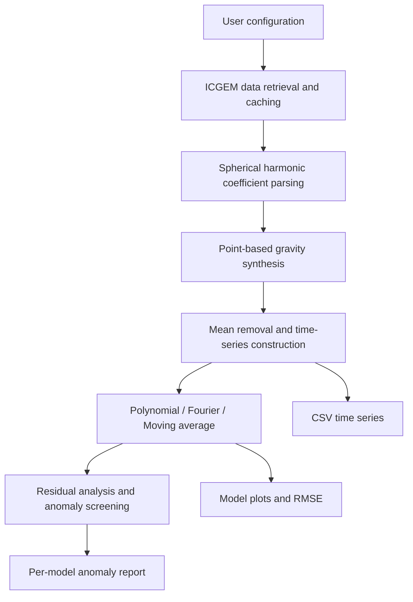

# Gravity Anomaly Time-Series Analysis Tool (grav-anom-tool v1.0)


[](MANUAL.pdf)

A lightweight, open-source Python toolkit for retrieving GRACE and GRACE Follow-On (GRACE-FO) satellite gravity field solutions from the International Centre for Global Earth Models (ICGEM), computing point-based gravity variation time series (Δg, µGal), and identifying model-dependent temporal anomalies.

The toolkit is designed for exploratory research in satellite gravimetry, temporal gravity field analysis, geodesy and earthquake-related geophysical investigations. It uses a configuration-driven workflow and requires no compilation or specialized build system.

## Documentation

**[Read the complete user manual (PDF)](MANUAL.pdf)**

The accompanying manual provides additional guidance on using the software. See the quick-start instructions below for the current repository layout and configuration.

## Key Features

- Automated retrieval and local caching of spherical harmonic coefficient files (`.gfc`) from ICGEM.
- GRACE and GRACE-FO gravity field solutions with a maximum available degree and order of 96.
- Point-based spherical harmonic synthesis at user-defined geographic coordinates.
- Mean-removed gravity time series in microgals (µGal).
- Polynomial regression, Fourier harmonic fitting and moving-average smoothing.
- Model-fit visualization, residual analysis and RMSE reporting.
- Configurable residual-based anomaly detection across multiple model orders and window sizes.
- CSV export and optional PNG plots.
- Configurable download timeouts, retries and request pacing.

## Data Sources

The software retrieves the following unfiltered 96 × 96 products through [ICGEM](https://icgem.gfz-potsdam.de/):

| Mission | Processing center | Release | Degree/order |
| --- | --- | --- | --- |
| GRACE | GFZ | RL06 | 96 |
| GRACE-FO | CSR | RL06.3 | 96 |

The source fields are unfiltered; the resulting time series is mean-centered, and optional temporal models are applied for exploratory analysis. Internet access is required to retrieve uncached data.

## Processing Workflow



## Installation and Quick Start

### Requirements

- Python 3.9 or later
- NumPy (required)
- Matplotlib (optional, for visualization)
- pandas (optional, for CSV export)

From the root of the cloned or extracted repository, create a virtual environment (recommended):

```bash
python3 -m venv .venv
source .venv/bin/activate
python -m pip install numpy
```

To enable optional visualization and pandas-based CSV export:

```bash
python -m pip install matplotlib pandas
```

Edit the supplied `config.ini` with the coordinates, date range and model settings, then run:

```bash
python3 main.py --config config.ini
```

Alternatively, on Linux:

```bash
bash run.sh
```

## Configuration

All principal settings are defined in [`config.ini`](config.ini). The following is an example configuration using the supplied sample coordinates:

```ini
[general]
lat = 38.60
lon = 141.25
start_date =
end_date =
nmax = 96
out_dir = outputs
cache_dir = icgem_cache

[models]
polynomial_degree = 1
fourier_terms = 4
moving_average_window = 3

[network]
request_timeout = 60
sleep_between_requests = 0.2
max_retries = 3
retry_backoff = 2.0

[model]
wanted_poly_degrees = 1,2
wanted_fourier_terms = 1,2,4
wanted_ma_windows = 3
anomaly_sigma_threshold = 2.0
take_last_anomalies = 3
```

| Section | Purpose |
| --- | --- |
| `[general]` | Geographic coordinates (decimal degrees), date range, harmonic truncation and storage paths. |
| `[models]` | Model parameters used for the principal fit and residual plots. |
| `[network]` | Download timeouts, retries and pacing. |
| `[model]` | Model parameter grids, residual threshold and number of recent anomalies to export. |

Dates use `YYYY-MM-DD`; leave the date fields blank to use the available data range. Moving-average windows should be positive odd integers. Keep the supplied configuration named `config.ini` in the working directory: the anomaly-report step currently reads this file name directly, even when an alternative configuration is passed to the CLI.

## Model-Based Anomaly Detection

For each selected model, residuals are calculated as the difference between the mean-removed gravity time series and its fitted values. A sample is flagged when the absolute residual exceeds a configurable multiple of the model residual scale:

$$
|r_i| > k\hat{\sigma}_r, \qquad r_i = \Delta g_i - \widehat{\Delta g}_i
$$

The default threshold is `k = 2.0`. The software exports up to the three most recent flagged samples per selected model, including the observation date, residual magnitude and nominal bounds of ±1.96 times the estimated residual scale. These bounds are descriptive and should not be interpreted as validated prediction intervals or significance tests.

## Output Files

For the example coordinates, results are written to `outputs/lat38.600_lon141.250/`:

| Output | Description |
| --- | --- |
| `lat38.600_lon141.250.csv` | Date and mean-removed gravity variation (µGal). |
| `lat38.600_lon141.250_timeseries.png` | Gravity time-series plot. |
| `lat38.600_lon141.250_polynomial.png` | Polynomial fit, RMSE and residuals. |
| `lat38.600_lon141.250_fourier.png` | Fourier fit, RMSE and residuals. |
| `lat38.600_lon141.250_moving_average.png` | Moving-average fit, RMSE and residuals. |
| `lat38.600_lon141.250_last_anomalies.csv` | Latest flagged residuals for each selected model. |
| `lat38.600_lon141.250_summary.txt` | Number of epochs and temporal coverage. |

PNG outputs require Matplotlib and successful model fitting. The anomaly report is generated when its processing step succeeds. CSV export falls back to Python's standard-library `csv` module when pandas is unavailable.

## Repository Structure

```text
grav-anom-tool_1.0/
├── grav_anom/
│   ├── __init__.py
│   ├── anomaly.py
│   ├── config_ext.py
│   └── core.py
├── config.ini
├── main.py
├── run.sh
├── MANUAL.pdf
├── README.md
└── LICENSE
```

## Scientific Considerations and Limitations

- The time series represents mean-removed gravity variations evaluated at a geographic point from finite-resolution satellite gravity field solutions; it is not a direct local gravimeter observation.
- GRACE/GRACE-FO solutions may contain hydrological, atmospheric, oceanic, processing-related and other geophysical contributions. Unfiltered fields may also exhibit correlated errors and striping.
- The combination of products from different processing centers warrants assessment of inter-series consistency, mission gaps and potential offsets.
- The Fourier fit used for plots employs harmonics over the observed record length, whereas the extended anomaly module uses annual harmonics. Moving-average edge handling also differs between the two modules; their residuals need not coincide.
- Residual exceedances are statistical screening indicators, not evidence of a tectonic origin or a validated earthquake prediction capability. Independent scientific validation is necessary before interpreting them as seismic precursors.

## Citation

If you use this software in academic work, please acknowledge the software and independently cite the GRACE/GRACE-FO products used in your analysis.

Suggested software citation:

> Hosseinchi, A. (2025). *Gravity Anomaly Time-Series Analysis Tool (grav-anom-tool)*, version 1.0 [Computer software]. GitHub.

## Author and Contact

**Amin Hosseinchi (A.H. Laplace)**  
Email: [ahosseinchi78@yahoo.com](mailto:ahosseinchi78@yahoo.com)

## License

Distributed under the MIT-style license included in [`LICENSE`](LICENSE).

Copyright © 2025 Amin Hosseinchi.
